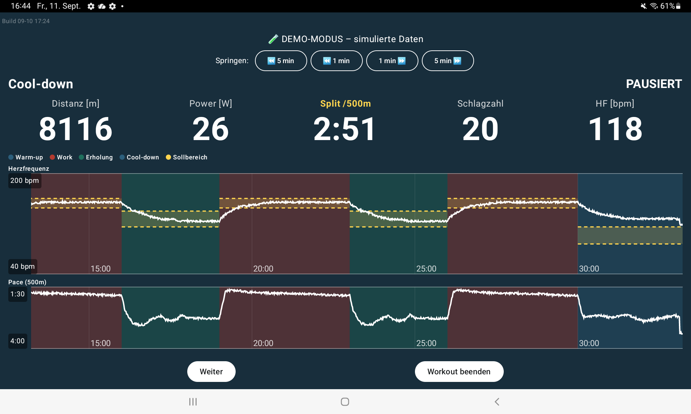

# Nordic4x4 Rower (N44R)

Android-App (Kotlin, Jetpack Compose) für strukturiertes Intervalltraining am Rudergerät,
mit Fokus auf das Norwegian/Nordic-4x4-Intervallprotokoll (4x 4 Minuten Belastung, 3 Minuten
aktive Erholung) – aber genauso für frei konfigurierbares Zeit-, Distanz- und
Intervalltraining mit eigenen Sollbereichen (Pace oder Herzfrequenz) nutzbar.

Verbindet sich direkt per Bluetooth LE (FTMS – Fitness Machine Service, offener
Bluetooth-SIG-Standard) mit dem Rudergerät, ganz ohne Cloud oder Herstellersoftware.

*Dashboard im Demo-Modus: Herzfrequenz- und Pace-Verlauf mit Phasenfärbung und Sollbereich.*

## Installation

Fertige, signierte APK zum direkten Installieren (kein Compiler nötig):
**[Neueste Version herunterladen](https://github.com/cyberdyne-multipass/nordic4x4-rower/releases/latest)**

**Schritt für Schritt (Android-Tablet oder -Handy):**
1. Obigen Link auf dem Tablet öffnen (z.B. über den Browser) und antippen, um die APK
   herunterzuladen.
2. Die heruntergeladene Datei antippen, um die Installation zu starten.
3. Falls eine Meldung wie *"Installation aus dieser Quelle nicht zulässig"* erscheint: auf
   **Einstellungen** in der Meldung tippen und **"Diese Quelle zulassen"** aktivieren (betrifft
   nur die App, mit der du die Datei geöffnet hast, z.B. den Browser oder Dateimanager – das
   ist eine normale Sicherheitsabfrage von Android bei Apps außerhalb des Play Store, kein
   Fehler). Danach zurückgehen und die Installation erneut starten.
4. **Installieren** antippen, danach **Öffnen**.

Beim allerersten Start fragt die App nach Standort-/Bluetooth-Berechtigungen (Android
verlangt das für BLE-Scans) – bitte erlauben, sonst kann sie das Rudergerät nicht finden.

## Rudergerät verbinden

1. Bluetooth auf dem Tablet einschalten (fall noch nicht an).
2. Das Rudergerät "aufwecken" – beim WaterRower S4 reicht ein paar Mal ziehen oder eine Taste
   am Monitor drücken, das ComModule sendet dann automatisch.
3. In der App beim ersten Start kurz Name/Alter usw. eingeben (für die Pulsberechnung), dann
   auf dem Startbildschirm **Start** antippen.
4. Die App verbindet sich automatisch mit dem Rudergerät (dauert meist wenige Sekunden) und
   zeigt **"Startklar"** an, sobald sie verbunden ist.
5. Losrudern – das Training beginnt automatisch beim ersten Schlag, kein weiterer Tipp nötig.

Ein manuelles "Koppeln" wie bei Kopfhörern ist nicht nötig – die App sucht und verbindet sich
selbst über den offenen BLE-Standard (FTMS). Die MAC-Adresse des Geräts wird nach dem ersten
erfolgreichen Verbinden gemerkt, damit künftige Verbindungen schneller gehen.

## Herzfrequenz (optional)

Für die Herzfrequenz-Anzeige lässt sich eine Apple Watch nutzen – allerdings kann eine Watch
nicht direkt mit Android-Geräten kommunizieren. Der Umweg: eine kostenlose Bridge-App auf
einem iPhone in der Nähe, die die Herzfrequenz der Watch empfängt und als normalen
Bluetooth-Herzfrequenzsensor weitersendet, den die App dann ganz normal erkennt.

**[HeartCast – Heart Rate Monitor](https://apps.apple.com/app/id1499771124)** (kostenlos,
App Store) ist eine solche Bridge-App. Einfach auf dem iPhone installieren, während des
Trainings geöffnet lassen und ein aktives Watch-Training starten – die App erkennt die
Herzfrequenz dann automatisch, sobald "Herzfrequenz (Brustgurt oder iPhone-Bridge)" in den
Einstellungen aktiviert ist.

**Brustgurt:** Jeder Bluetooth-Herzfrequenzgurt (Standard-Heart-Rate-Service) funktioniert,
getestet mit dem **Garmin HRM 600**. In den Einstellungen unter *Herzfrequenz-Sensor* auf
**Sensor suchen** tippen und den Gurt auswählen – die App bevorzugt ihn dann und nimmt die
iPhone-Bridge nur als Ersatz, falls der Gurt nicht gefunden wird. Hinweis zum HRM 600: im
Modus "sichere Verbindung" muss er einmal gekoppelt werden (Knopf 4 s halten = Kopplungsmodus,
die App fordert die Kopplung dann selbst an); alternativ per Doppeldruck auf "offene
Verbindung" umstellen. Gurte mit RR-Intervallen (Schlag-zu-Schlag-Abstände) werden zusätzlich
als CSV aufgezeichnet und zur Plausibilitätsprüfung genutzt: ohne Hautkontakt liefert z. B.
der HRM 600 erfundene Pulswerte, die die App daran erkennt und verwirft.

## Kompatibilität

Entwickelt und getestet mit einem **WaterRower S4 + ComModule**. Da FTMS ein offener,
herstellerunabhängiger Standard ist, sollte die App grundsätzlich mit jedem Rudergerät
funktionieren, das die Fitness-Machine-Rower-Data-Characteristic (0x2AD1) über BLE anbietet –
das wurde bisher aber nur mit dem oben genannten Gerät verifiziert. Rückmeldungen zu anderen
Geräten sind willkommen.

Dieses Projekt steht in keiner Verbindung zu WaterRower Inc. – "WaterRower" ist eine
eingetragene Marke des jeweiligen Rechteinhabers.

## Funktionen

- Zeit-, Distanz- und Intervalltraining (inkl. Nordic-4x4-Preset)
- Frei konfigurierbare Sollbereiche (Pace oder Herzfrequenz) für Belastungs- und
  Erholungsphasen
- Live-Diagramm (Herzfrequenz + Pace) mit Phasenfärbung und Sollbereich-Anzeige
- FIT-Export (eigener, schlanker Encoder) sowie Bild- und Rohdaten-Export
- Demo-Modus zum Testen ohne angeschlossenes Rudergerät
- Robustheit: Verbindungs-Watchdog mit automatischem Neuverbinden (Rudergerät und
  Herzfrequenz), auffällige Warnungen mit unterscheidbaren Warntönen, Signalanzeige
  (Signalstärke + Paketfluss) mit Frühwarnung bei schwachem Empfang
- Absturzsicher: jedes Training wird laufend mitgeschrieben und lässt sich nach einem Absturz
  (oder versehentlichem Beenden) fortsetzen – auch ab einem früheren Zeitpunkt
- Herzfrequenz-Dynamik: HF-Erholung 60 s nach jedem Intervall (HRR60) und HF-Anstiegszeit
- Kurze HF-Aussetzer werden interpoliert, ungültige Werte (z. B. 0) verworfen

## Lizenz

MIT License, siehe [LICENSE](LICENSE).
